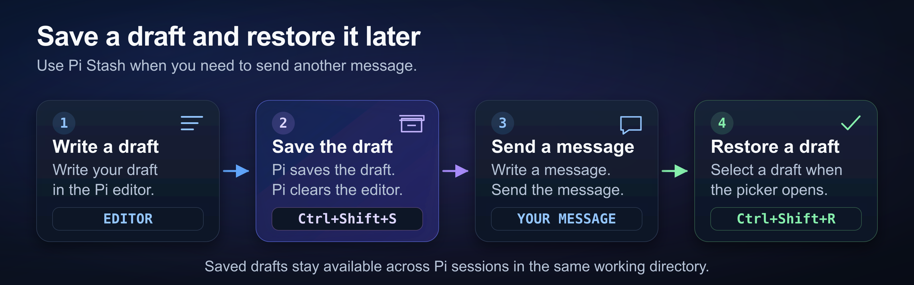

# pi-stash

Pi Stash is a [Pi](https://github.com/earendil-works/pi) extension that saves editor drafts. Use it to save a draft before you send another message.



The diagram shows how to save and restore a draft in Pi.

## Install

Use Pi 1.0.0 or later and Node.js 24.15.0 or later.

```bash
pi install npm:@fitchmultz/pi-stash
```

Restart Pi after you install or update the extension.

See the [development guide](docs/development.md) for GitHub and local installation.

## Usage

1. Write a draft in the editor.
2. Press Ctrl+Shift+S to save the draft and clear the editor.
3. Send another message.
4. Press Ctrl+Shift+R to restore a draft.
5. Continue to edit the draft.

Pi Stash opens a picker when more than one draft exists. In the picker, press Enter to restore the selected draft.

Pi Stash removes a draft from storage after you restore it. If the editor contains text, Pi Stash pastes the draft into that text.

The footer shows the saved draft count.

## Commands and shortcuts

| Shortcut or command | Action |
| --- | --- |
| `/stash` | Saves the editor draft and clears the editor |
| `/stash some text` | Saves the supplied text and leaves the editor unchanged |
| `/stash-list` | Opens the picker to restore or delete drafts |

The picker uses Pi's navigation and confirmation keys. Press Ctrl+D to delete the selected draft. Press Ctrl+X to clear all drafts after confirmation.

If a shortcut does not work in your terminal, use `/stash` or `/stash-list`.

## Saved drafts

Pi Stash stores up to 10 drafts per working directory, newest first. A new draft replaces the oldest draft when the list is full. Save important drafts elsewhere before you reach this limit.

Pi Stash saves drafts as unencrypted JSON in your Pi agent directory. Saved drafts remain available after a restart or crash.

Pi windows and sessions in the same working directory share saved drafts. Simultaneous changes in separate windows can overwrite drafts. Change saved drafts from one window at a time.

Pi Stash ignores blank drafts. The `/stash some text` command preserves leading and trailing whitespace.

See the [storage and client reference](docs/reference.md) for file locations, client behavior, and imports from older versions.

## Development

See the [development guide](docs/development.md) for tests, compatibility checks, and releases.

[Changelog](CHANGELOG.md) · [Report a problem](https://github.com/fitchmultz/pi-stash/issues)

[MIT license](LICENSE) · Created by [Mitch Fultz](https://github.com/fitchmultz)
